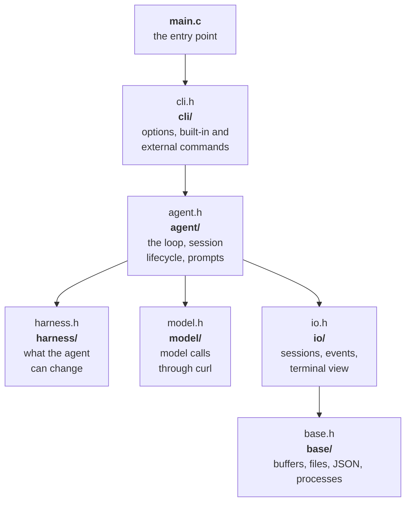

# Architecture

arx is one small C binary that runs the turn loop, with every tool, hook,
command and front-end around it running as a separate process. If you work
on arx itself, start with the design decisions, then the source layout, then
how to build, test and benchmark.

## Design decisions

Each decision trades a feature in the core for a process or a file outside
it:

| Decision | Why |
|---|---|
| **One C binary, two vendored libraries** | It starts in under a millisecond, uses a few MB over hundreds of turns, and runs anywhere without a runtime. cJSON and libyaml are vendored, unmodified. |
| **Plugins are processes** | Any language works, a crash can't take the core down, and the agent can write plugins with the same tools it uses for the task. |
| **Model calls through `curl`** | Every request goes through `HttpRun`, which runs curl natively. The binary has no TLS or HTTP code. curl handles proxies, certificates and HTTP/2. The API key goes in a 0600 header file, never on the command line. |
| **Hot reload by `stat()`** | A fingerprint of the harness files costs microseconds, so arx checks before every model call instead of watching files. |
| **One field table for the spec** | Validation, "did you mean" hints and `arx schema` all come from `kTopFields` in `fields.c`. Adding a key adds it to all three. |
| **Errors go to the agent** | A rejected edit or a broken tool becomes a `[harness]` note with enough detail for the agent to fix it itself. |
| **Observers can't block** | The event pipe is non-blocking. A slow observer loses events; the agent never waits. |
| **One platform section** | Processes, signals, exec, observers, sleeping and HTTP sit behind the platform section of `src/base/base.h`. Natively `proc.c` and `proc_posix.c` implement it, and `proc_host.c` in the browser build. Nothing else in `src/` makes a process call, and `make lint` and `make wasm` check it. |
| **Every plugin in its own process group** | A timeout or Ctrl-C kills the whole group: SIGTERM, then SIGKILL 3 seconds later. No orphans. |
| **Commands are plugins too** | `arx setup`, `init`, `doctor`, `models`, `sessions`, `update`, `plugin`, `kit`, `add` and `config` are small scripts named `arx-<name>`, run git-style. The binary stays small, and anyone can add a command. |
| **Files are the interface** | Sessions, transcripts, events and the control inbox are plain files, so drivers and front-ends need no library. |

## Performance budgets

arx has four performance budgets, and `make bench` fails if a build misses
one:

| Budget | Limit | macOS (arm64) | Linux (static, musl) |
|---|---|---|---|
| Binary size | 400 KB (macOS), 1 MB (Linux) | 183 KB | 258 KB, libc included |
| Startup, above `true` | 1 ms | 0.6 ms | within noise |
| Peak memory over 500 turns | 16 MB | 4 MB | 7 MB |
| Harness edit to live | 10 ms | 0.10 ms | 0.05 ms |

A new tool is slower to go live than an edit. On macOS, a tool the agent has
just created takes about 35 ms, because the OS checks every new executable
the first time it runs. On Linux it takes 0.2 ms.

## Source layout

`src/` has one folder per layer and one header per folder. A layer only uses
the layers below it.

Every source file, by folder:

| Folder | File | What it holds |
|---|---|---|
| | `main.c` | the entry point: signals, then the command line |
| `cli/` | `options.c` | option parsing, spec lookup and usage errors |
| | `commands.c` | built-in commands: `schema`, `tool`, `watch`, `ctl`, `request`, `version`, `help` |
| | `check.c` | `arx check` and `arx tools` |
| | `shell_tools.c` | the `bash` and `edit` tools behind `arx tool NAME` |
| | `external.c` | `arx foo` runs `arx-foo`; `arx help` lists every command |
| `agent/` | `loop.c` | the turn loop: caps, reload, inbox, notes, compaction, tool calls, stop hook |
| | `model_call.c` | one model call through its hooks |
| | `tool_calls.c` | the tool runtime, over the session's call table |
| | `scheduler.c` | the scheduler plugin, which decides when queued tool calls run |
| | `run.c` | session lifecycle: load, open or resume, observers, headless or interactive, result |
| | `agent.c` | caps parsing, notes, the system prompt and `{{templates}}` |
| `harness/` | `spec.c` | YAML to JSON with line numbers, `--set`, merging over `config.yaml` |
| | `plugins.c` | the layers: spec folder, project plugins, config folder, user plugins |
| | `active.c` | the active list: the ordered plugins one run uses |
| | `kits.c` | kits |
| | `signature.c` | the hot-reload fingerprint, over every layer, by `stat()` |
| | `fields.c` | the field tables of `agent.yaml`, `plugin.yaml` and `kit.yaml` |
| | `validate.c` | validation against the field tables |
| | `schema.c` | the JSON Schema, from the same table |
| | `describe.c` | `arx check --plugin DIR`: checks one plugin without loading it |
| | `tools.c` | finds tools and caches their `--schema` |
| | `keys.c` | the keys of a tool call |
| | `tool_exec.c` | runs one tool call; subagents run arx again |
| | `hooks.c` | runs `hooks/<point>`: one hook, its options and band, and the `session_start` and `stop` points |
| | `chain.c` | the hook chain over one raw object, around the model and tool calls |
| | `compact.c` | the compaction strategies |
| `model/` | `llm.c` | builds the request, sends it with `HttpRun`, classifies errors, retries |
| | `auth.c` | finds the API key (environment, Keychain or credentials file) and builds the request headers |
| | `credential.c` | runs the credential program (`endpoint.credential`) and finds the adapter (`endpoint.adapter`) |
| | `sse.c` | parses the streamed reply |
| `io/` | `session.c` | session folders, transcript, meta, inbox |
| | `events.c` | the event stream and observers |
| | `render.c` | the terminal view and `arx watch` |
| `base/` | `util.c` | buffers, files, paths, durations and sizes |
| | `json.c` | small cJSON helpers |
| | `proc.c` | the process runner: pipes, timeouts, process groups, and children kept for the session |
| | `proc_posix.c` | the rest of the platform natively: signals, exec, the executable check, observers, sleeping, and `HttpStart` by curl |
| | `proc_host.c` | the platform in the browser build, on the host interface that `arx.js` serves; `make wasm` uses it in place of `proc.c` and `proc_posix.c` |
| | `http.c` | `HttpRun`: one HTTP request, start to end |
| | `rpc.c` | JSON-RPC 2.0 over JSON lines, in either role, with no I/O of its own, for MCP servers and `arx acp` |

## Building and testing

Every build, test and release step is a `make` target:

| Command | What it does |
|---|---|
| `make` | release build: `-Os`, LTO, dead code stripped |
| `make debug` | `./arx-debug` with AddressSanitizer and UBSan |
| `make test` | the unit tests of `src/base` (`tests/base_test.c`), then 558 end-to-end checks in ten suites against `tests/fake-curl` (49 core, 34 marketplace plugins, 46 plugin loading, 61 CLI, 56 shell plugin, 70 hooks, 56 tool runtime, 70 kits, 81 credentials, 35 plugin state). No network or API key needed. |
| `make bench` | the [performance budgets](#performance-budgets) |
| `make lint` | clang-format, cpplint, files of 400 lines or fewer, doc comments, and process calls only in `proc.c` and `proc_posix.c` |
| `make format` | rewrites `src/` in Google style |
| `make static` | a static Linux (musl) binary, built in Docker |
| `make wasm` | `arx.wasm`, the core for browsers, with `zig cc -target wasm32-wasi` (or `WASI_CC`) and `wasm-opt -Oz` when it is installed; `scripts/wasm-imports.sh` then fails the build on an import the host interface doesn't have |
| `make install` | `arx` into `$(PREFIX)/bin`, and its commands, plugins and kits into `$(PREFIX)/libexec/arx` (default `~/.local`) |
| `make dist` | the release tarball and its sha256 for this platform, as CI builds them |

The tests run the debug build, so every check also runs under the
sanitizers. `tests/fake-curl` stands in for curl and replays scripted model
replies, so the whole loop runs offline.

## CI and releases

GitHub Actions builds, tests and publishes arx:

- **CI** runs on every push to `main` and every pull request: lint, with
  clang-format 23.1.3 and cpplint 2.0.2 pinned, then the core, marketplace
  plugin, plugin loading and CLI suites and the four performance budgets
  against a static Linux build, and the browser build: `make wasm` with zig
  0.17.1 (checked by SHA-256) and binaryen 132, its import check, and a
  300 KB size budget.
- **Releases** build `darwin-arm64`, `darwin-x86_64`, `linux-x86_64` and
  `linux-arm64`, and run the tests and budgets on macOS and Linux before
  publishing, so a slow or oversized build fails the release. Each tarball
  ships with a `.sha256`, which `install.sh` and `arx update` check.
- **Startup timing** is measured against `true` on the same machine, and
  measured again once before it fails, because shared CI machines are noisy.
- **Docs**: `.github/workflows/docs.yml` calls the docs site's deploy hook
  when `docs/` changes on `main`.

## Code style

The C sources follow Google style with a few rules of their own: files of at
most 400 lines, a comment on every file and function, and comments that say
why. The [style guide](STYLE.md) has the full rules.
