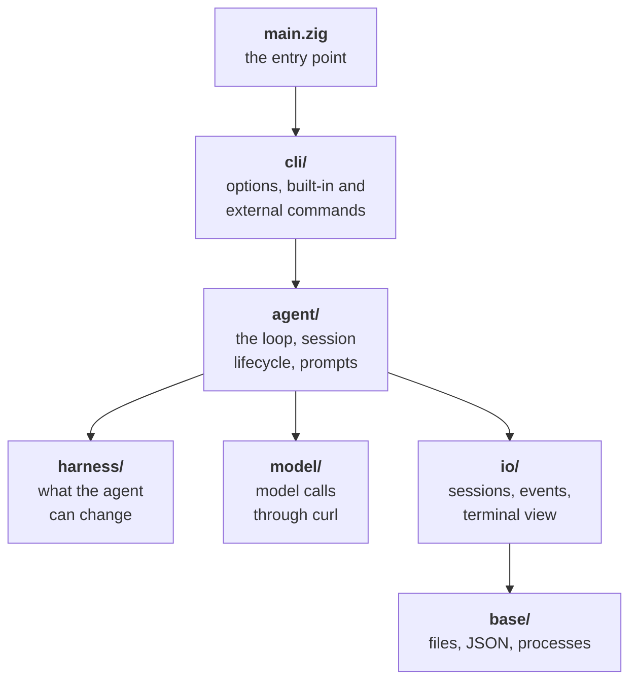

# Architecture

This page is for people who work on arx itself. It covers the design
decisions, the layout of the sources, and how to build, test and benchmark.

## Design decisions

| Decision | Why |
|---|---|
| **One Zig binary, one vendored library** | Starts in under a millisecond, uses a few MB over hundreds of turns, and runs anywhere without a runtime. JSON is Zig's own `std.json`. libyaml is vendored unmodified, because Zig has no YAML parser and libyaml gives the line numbers that error messages need. |
| **One pinned Zig release** | Zig changes its standard library between releases, so arx builds with exactly one: 0.17.0. `build.zig` refuses any other, and CI, the Makefile and `build.zig.zon` name the same version. Upgrading is one deliberate change. |
| **Plugins are processes** | Any language works, a crash cannot take the core down, and the agent can write plugins with the same tools it uses for the task. |
| **Model calls through `curl`** | No TLS or HTTP code in the binary. curl handles proxies, certificates and HTTP/2. The API key goes in a 0600 header file, never on the command line. |
| **Hot reload by `stat()`** | A fingerprint of the harness files costs microseconds, so arx checks before every model call instead of watching files. |
| **One field table for the spec** | Validation, "did you mean" hints and `arx schema` all come from `top_fields` in `validate.zig`. Adding a key adds it to all three. |
| **Errors go to the agent** | A rejected edit or a broken tool becomes a `[harness]` note with enough detail for the agent to fix it itself. |
| **Observers cannot block** | The event pipe is non-blocking. A slow observer loses events; the agent never waits. |
| **Every plugin in its own process group** | A timeout or Ctrl-C kills the whole group: SIGTERM, then SIGKILL 3 seconds later. No orphans. |
| **Arenas, not individual frees** | Each loaded spec, tool set, event and message owns an arena and frees it at once. Compaction drops old messages and their memory with them, so a run can last for days. |
| **Commands are plugins too** | `arx setup`, `init`, `doctor`, `models`, `sessions`, `update` and `plugin` are small scripts named `arx-<name>`, run git-style. The binary stays small, and anyone can add a command. |
| **Files are the interface** | Sessions, transcripts, events and the control inbox are plain files, so drivers and front-ends need no library. |

## Performance budgets

`make bench` measures these and fails if one is missed:

| Budget | Limit | macOS (arm64) | Linux (static, musl) |
|---|---|---|---|
| Binary size | 400 KB (macOS), 1 MB (Linux) | 393 KB | 449 KB, libc included |
| Startup, above `true` | 1 ms | 0.8 ms | within noise |
| Peak memory over 500 turns | 16 MB | 5 MB | 7 MB |
| Harness edit to live | 10 ms | 0.28 ms | 0.09 ms |

The release build is optimized for size, single-threaded (children are
processes, not threads), and prints a panic's message without a stack trace,
which keeps the stack-trace machinery out of the binary. JSON numbers stay as
text until arx reads them, with the C library's `strtod`, so the binary
carries no float parser and its tables.

On macOS, a tool the agent has just created takes about 40 ms to go live,
because the OS checks every new executable the first time it runs. On Linux it
takes 0.3 ms.

## Source layout

`src/` has one folder per layer. A layer only uses the layers below it; the
one exception is that harness and model code take the `Agent` they work for.

| Folder | File | What it holds |
|---|---|---|
| | `main.zig` | the entry point: signals, then the command line |
| `cli/` | `options.zig` | option parsing, spec lookup and usage errors |
| | `commands.zig` | built-in commands: `schema`, `tool`, `watch`, `ctl`, `request`, `version`, `help` |
| | `check.zig` | `arx check` and `arx tools`: load the harness and report it, with warnings |
| | `shell_tools.zig` | `bash` and `edit`, which the shell plugin runs as `arx tool NAME` |
| | `external.zig` | `arx foo` runs `arx-foo`; `arx help` lists every command |
| `agent/` | `loop.zig` | the turn loop: caps, reload, inbox, notes, compaction, stop hook |
| | `model_call.zig` | one model call through the `before_model` and `after_model` hooks |
| | `tool_calls.zig` | the tool runtime: `before_tool`, the queue by keys, `after_tool`, results in call order |
| | `scheduler.zig` | a scheduler plugin: one process that decides when queued calls start |
| | `run.zig` | session lifecycle: load, open or resume, observers, headless or interactive, result |
| | `agent.zig` | the `Agent`, caps parsing, notes, the system prompt and `{{templates}}` |
| `harness/` | `yaml.zig` | libyaml to JSON, with the line of every key |
| | `spec.zig` | loading the spec, `--set`, merging over the kit and `config.yaml`, text files |
| | `active.zig` | the active list: which plugins a run uses, in which order |
| | `kits.zig` | kits: `kit.yaml`, `extends`, `kit.lock` |
| | `plugins.zig` | the layers: spec folder, then the active list, or every installed plugin |
| | `describe.zig` | `arx check --plugin`: one plugin, without loading it |
| | `signature.zig` | the hot-reload fingerprint, over every layer, by `stat()` |
| | `fields.zig` | the field tables of `agent.yaml`, `plugin.yaml` and `kit.yaml` |
| | `validate.zig` | validation against them, with "did you mean" hints |
| | `schema.zig` | the JSON Schema, from the same table |
| | `tools.zig` | finds tools and caches their schemas (`<name>.json` or `--schema`) |
| | `keys.zig` | the keys of a tool call, which say what may run together |
| | `tool_exec.zig` | starts and ends one tool call; subagents run arx again |
| | `hooks.zig` | runs `hooks/<point>` by band, as a chain over raw objects |
| | `compact.zig` | the compaction strategies |
| `model/` | `llm.zig` | builds the request, runs curl, classifies errors, retries |
| | `auth.zig` | finds the API key (environment, Keychain or credentials file) and writes the 0600 header file |
| | `sse.zig` | parses the streamed reply |
| `io/` | `history.zig` | the conversation; each message owns an arena |
| | `session.zig` | session folders, transcript, meta, inbox |
| | `events.zig` | the event stream and observers |
| | `render.zig` | the terminal view and `arx watch` |
| `base/` | `context.zig` | the allocator, `std.Io`, environment and binary path every layer gets |
| | `util.zig` | files, paths, durations, sizes, UTF-8 and time |
| | `json.zig`, `json_write.zig` | dotted-path lookups on `std.json` values, and writing them |
| | `proc.zig` | the process runner: one `poll()` loop for many children, timeouts, process groups |
| | `sys.zig` | the few POSIX calls `std.Io` does not cover, and the interrupt flag |

## Building and testing

arx needs [Zig 0.17.0](https://ziglang.org/download/), exactly. Set `ZIG` to
use a zig that is not on `PATH`.

| Command | What it does |
|---|---|
| `make` | release build `./arx`: optimized for size, stripped |
| `make debug` | `./arx-debug` with safety checks (bounds, overflow, null) and leak reports |
| `make test` | the Zig unit tests, then 180 end-to-end checks against `tests/fake-curl` (47 core, 30 marketplace plugins, 46 plugin loading, 57 CLI). No network or API key needed. |
| `make bench` | the performance budgets above |
| `make lint` | `zig fmt`, files of 400 lines or fewer, doc comments |
| `make format` | rewrites `src/` with `zig fmt` |
| `make static` | static Linux (musl) binaries for x86_64 and arm64, cross-compiled |
| `make install` | `arx` into `$(PREFIX)/bin` and its commands into `$(PREFIX)/libexec/arx` (default `~/.local`) |
| `make dist` | the release tarball and its sha256 for this platform (or `TARGET=`), as CI builds them |

`zig build` works too: `zig build -Doptimize=debug`, `zig build test`, and
`-Dtarget=x86_64-linux-musl` for another platform. The Makefile adds the
copies at `./arx` and `./arx-debug`, where the tests and docs expect them.

The end-to-end tests run the debug build, so every check also runs with Zig's
safety checks on, and a test fails if the run leaks memory or panics.
`tests/fake-curl` stands in for curl and replays scripted model replies, so the
whole loop runs offline. Unit tests sit in the file they test, in `test`
blocks.

## CI and releases

- **CI** (GitHub Actions) runs on every push to `main` and every pull request:
  lint, then the unit and end-to-end tests on the debug build, then the four
  performance budgets against the static Linux release build. Every job
  installs the pinned Zig with `mlugg/setup-zig`.
- **Releases** build `darwin-arm64`, `darwin-x86_64`, `linux-x86_64` and
  `linux-arm64`, and run the tests and budgets on macOS and Linux before
  publishing, so a slow or oversized build fails the release. Zig
  cross-compiles, so the macOS runner builds both macOS targets. Each tarball
  ships with a `.sha256`, which `install.sh` and `arx update` check.
- **Startup timing** is measured against `true` on the same machine, and
  measured again once before it fails, because shared CI machines are noisy.
- **Docs**: `.github/workflows/docs.yml` calls the docs site's deploy hook when
  `docs/` changes on `main`.

## Code style

The Zig sources follow `zig fmt` and Zig's naming, with a few rules of their
own: files of at most 400 lines, a doc comment on every file and function, and
comments that say why. See the [style guide](STYLE.md).
