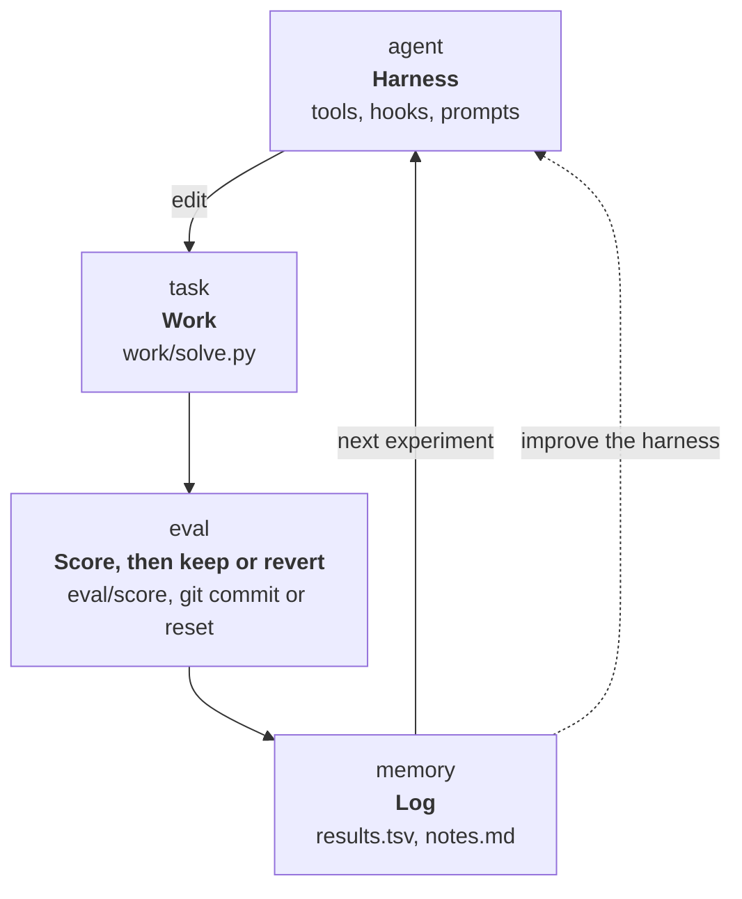

# Self-improving runs

A self-improving run is an agent that hill-climbs one score for hours without
supervision: it tries an idea, measures it, keeps it if the score got better,
and tries the next one. Along the way it improves its own harness: it writes
tools that make its loop faster, hooks that catch its mistakes, and skills
that record what it learned.

arx was built for this autoresearch-style loop. Use it when one command can
score your task with one number. The complete example is
[`examples/tsp`](../examples/tsp), an agent that makes a travelling-salesman
solver faster and better on a CPU.

## The shape of a run



A good setup has four parts:

1. **A score**: one command that prints one number. In the TSP example,
   `python3 eval/score` prints the mean tour length; lower is better.
2. **A loop in the prompt**: the system prompt tells the agent to pick an
   idea, commit it, score it, log it, and keep or revert it.
3. **Memory in files**: `results.tsv` and `notes.md` hold what was tried and
   what was learned. arx can clear the context at any time without losing
   anything.
4. **A harness the agent may change**: `{{harness}}` in the prompt tells the
   agent where its tools, hooks and skills live.

## Never stop: the stop hook

A model ends its turn when it thinks it is done. For an open-ended climb,
add a `stop` hook that sends it straight into the next experiment:

```sh
#!/bin/sh
# hooks/stop
echo '{"decision":"continue","message":"Next experiment. Log it in results.tsv and keep notes.md current."}'
```

The run then ends only at a cap (`--cap usd=5`, `--cap wall=2h`), at
`arx ctl last stop`, or when you press Ctrl-C.

> [!WARNING]
> With this hook, the agent never decides it is done. Always start the run
> with `--cap usd` or `--cap wall`, or it keeps spending until
> `limits.max_turns`, which the agent can raise.

## Memory in files: restart compaction

For a long climb, use `compaction: {strategy: restart}`. When the context
fills, arx clears it and starts again from the system prompt and the first
message. A first message like this pulls the memory back in:

```markdown
{{file:program.md}}

Results so far (results.tsv, last 20 lines):
{{file:results.tsv:tail=20}}

Your notes (notes.md):
{{file:notes.md:max=8kb}}

Your skills:
{{skills}}
```

The TSP example's `prompts/first.md` also adds `{{prompt}}` and
`{{harness}}`. Every restart is then a fresh, short context with the current
state, instead of a long one that degrades. This is the "Ralph loop"
pattern. [Context and compaction](concepts.md#context-and-compaction)
compares it with the other strategies.

## Let the agent improve itself

Ask for it in the prompt. The TSP example says:

> Make yourself faster and better as you go. For example, write a tool that
> runs steps 2 to 5 in one call, a skill that records what you learned about
> the problem, or a hook that checks a tour before a full run.

An agent can build these for itself:

- **A tool that runs one whole experiment**: commit, score, log, keep or
  revert, in one call. This cuts four or five turns per experiment to one.
  Under [`arx climb`](climb.md) the tool only edits and checks: climb
  commits, scores and keeps.
- **A fast eval tool**: scores a smaller input, to reject bad ideas in
  seconds.
- **An `after_tool` hook**: adds the current best score to every result.
- **A skill**: records the approaches that worked and the ones that did
  not, so they survive restarts.
- **Spec edits**: a longer tool timeout, a different temperature, a smaller
  compaction trigger.

Each change is live on the next turn. arx rejects or reports a broken
change, and the run goes on.

## Run the TSP example

The example's spec uses OpenRouter, so it needs `OPENROUTER_API_KEY` in the
environment, or saved by `arx setup --provider openrouter`. To use your own
defaults instead, delete its `model` and `endpoint` lines.

1. Copy the example into its own git repository:

   ```sh
   cp -r examples/tsp /tmp/tsp && cd /tmp/tsp
   printf 'results.tsv\nnotes.md\nrun.log\n.arx/\n' > .gitignore
   git init -q && git add -A && git commit -qm baseline
   ```

2. Start the loop, with a budget and a time limit:

   ```sh
   arx --spec harness/agent.yaml --set model=<model id> \
     -p "Start the experiment loop." --cap usd=5 --cap wall=2h
   ```

3. From another terminal in the same folder, follow the run and steer it:

   ```sh
   arx watch                             # follows the run live
   arx ctl last note "try Or-opt next"   # the agent sees it before its next model call
   ```

When the run ends, you have:

- **`results.tsv`**: every experiment and its score.
- **`git log`**: the solver changes that were kept.
- **`harness/`**: what the agent built for itself.

Check the result on instances the agent was not scored on:

```sh
python3 eval/score --holdout
```

To start a harness of your own instead, run `arx init autoresearch`. It
writes the same pieces into the current folder: a program, an
experiment-loop prompt, a never-stop hook and restart compaction.

## Let arx climb keep the score

[`arx climb`](climb.md) runs the same example in rounds and scores each
change itself, with its own copy of `eval/`, so the agent never runs the
scorer that counts. The example's `climb.yaml` sets what is scored and the
budget.

1. Copy the example into its own git repository, without its never-stop
   hook, which would keep each round going to its turn cap:

   ```sh
   cp -r examples/tsp /tmp/tsp-climb && cd /tmp/tsp-climb
   rm harness/hooks/stop
   printf 'results.tsv\nnotes.md\nrun.log\n.arx/\n' > .gitignore
   git init -q && git add -A && git commit -qm baseline
   ```

2. Score the baseline, then start the climb:

   ```sh
   arx climb --dry-run --set model=<model id>   # scores the start 3 times
   arx climb --set model=<model id>             # rounds until the budget ends
   ```

The prompt changes with it. `climb.yaml` points `instructions` at
`harness/prompts/climb.md`, which asks for one change to `work/solve.py`
per round. It has no scorer step and no keep or revert step: climb does
both, and tells the agent the result at the start of the next round.

When the climb ends, the branch `climb/RUN` holds only kept, scored commits,
`.arx/climb/last/results.tsv` holds every round, and `summary.json` has the
holdout score of the starting version and of the best.

## Before a long run

Check each of these before you leave a run alone:

| Check | What to do |
|---|---|
| **Caps** | Always set `--cap usd` or `--cap wall`. The agent can raise `limits.max_turns`, but not a cap. |
| **Git** | Run in its own repository, so every kept change is a commit and a revert is cheap. |
| **Holdout** | Keep instances the agent never sees, and check the final result on them. |
| **Isolation** | Tools run as your user. Use a container or VM for anything you would not run yourself. |
| **Trust** | Run the climb with [`arx climb`](climb.md), so the agent never runs the scorer that counts. |
| **Plugins** | Name the plugins a run may use, such as `plugins: [guard]`, or `plugins: []` for none, so a plugin you install later can't change the run. |
| **Observe** | Run `arx watch`, or an observer that posts to a channel, so you see a run go wrong early. |

## Related

- [How arx works](concepts.md): the turn loop, hot reload, caps and
  compaction.
- [Hooks](plugins/hooks.md): every hook point, including `stop` and
  `after_tool`.
- [arx climb](climb.md): run the loop in rounds, with a scorer the agent
  can't reach.
- [Policies](plugins/policies.md): a policy folder decides which harness
  edits load. Without a sandbox it stops mistakes, not a hostile agent.
- [`examples/tsp`](../examples/tsp): the complete self-improving TSP solver.
