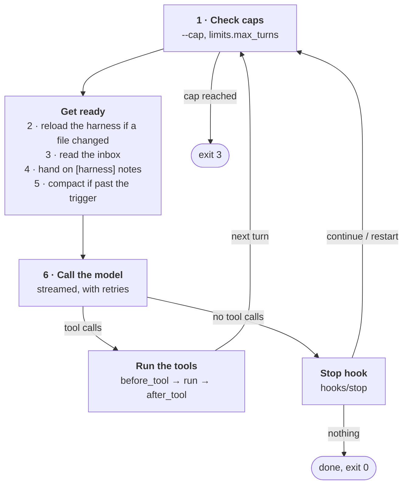

# How arx works

arx runs one agent: a model, a set of tools and a conversation, in a loop of
model calls and tool calls. It is built for long runs without supervision,
where the agent also changes the harness it runs in.

Knowing the loop tells you what the agent can change, what it can't, and
where to look when a run goes wrong.

## The three parts

Every run has three parts, and each one has a different owner:

| Part | What it is | Who changes it |
|---|---|---|
| **The core** | one C binary: the turn loop, model calls, sessions, events | nobody at run time |
| **The harness** | the spec (`agent.yaml`), its prompts, and the `tools/`, `hooks/` and skills next to it, over your defaults and installed plugins | you, and the agent itself |
| **The work** | the directory arx runs in: the code, data and files the task is about | the agent, through its tools |

The core does as little as possible. Everything else is a plugin: an
executable in any language that arx runs and talks to with JSON. The
[plugin guide](plugins.md) covers every kind.

### Layers

arx reads the harness from up to four places, in order:

1. The spec folder.
2. The project's `plugins/`.
3. Your config folder (`~/.config/arx/`).
4. The plugins you installed.

For tools, the first layer wins, so a tool the agent writes beats a
plugin's, unless the plugin lists the name in `replaces:`. Hooks from every
layer run in order. A [policy folder](plugins/policies.md) that you name
with `--policy DIR` loads before all four, and its tools win.

A spec that lists `plugins: [...]` uses only the spec folder and the plugins
it names. Use it for any run you need to repeat: a plugin you install later
can't change it. [Plugin folders](plugins/concepts.md#layer) has the details.

## The turn loop

One turn is one model call. Before each call, arx gets the harness and the
context ready. After it, arx runs the tools the model asked for.



Each turn goes through six steps:

1. **Caps**: if a `--cap` or `limits.max_turns` is reached, arx stops the
   run with exit code 3.
2. **Hot reload**: arx fingerprints every harness file with `stat()`. If one
   changed, it reloads the spec, the tools and the system prompt. The check
   costs about 0.1 ms when nothing changed. arx checks linked plugins the
   same way.
3. **Inbox**: arx applies the commands from `arx ctl`: a note for the agent,
   or a request to stop.
4. **Notes**: problems arx found (a rejected spec edit, a broken tool, an
   operator note) reach the agent as one `[harness]` message.
5. **Compaction**: if the prompt passed `compaction.trigger × context_window`,
   arx makes the context smaller with the spec's strategy.
6. **Model call**: arx sends the request through `curl`. It retries network
   errors, 429s and 5xx answers with backoff. If the provider says the
   prompt is too long, arx compacts once and tries again.

After the call, what arx does depends on the reply:

- **Tool calls**: arx runs them one after the other. Each goes through the
  `before_tool` hook (which can deny it), runs, and goes through the
  `after_tool` hook (which can add a note to the result).
- **No tool calls**: the agent thinks it is done, and the `stop` hook
  decides. It can send a message and `continue`, `restart` from a fresh
  context, or say nothing, which ends the run.

## The harness edits itself

The agent can change its own harness while it runs, and the change is live
on the next turn. Put `{{harness}}` in the system prompt: it tells the agent
where its spec, tools, hooks and skills are and how to change them. Because
arx reloads before every model call, an edit made in turn 12 is live in
turn 13.

The agent can make three kinds of change:

- **A new tool**: any executable the agent writes to `tools/`.
- **A new hook**: any executable at `hooks/<point>`.
- **A spec edit**: the model settings, the compaction strategy, the tool
  timeouts and the prompts.

By default every edit loads. To decide which edits load, start the run with
a [policy folder](plugins/policies.md): `arx --policy DIR`. Before arx loads
a changed harness, the policy's `harness_edit` hook sees each changed file
and accepts or rejects it, and arx writes the accepted version back over a
rejected one. "The agent may edit prompts, but not hooks" is one hook of a
few lines.

### Bad edits are safe

If the agent writes a spec that does not validate, arx keeps the previous
version and tells the agent what is wrong, with the line number and a "did
you mean" hint:

```text
[harness]
Your harness edit was rejected; the previous version is still in use:
harness/agent.yaml:14: compaction.stratgy: unknown key (did you mean "strategy"?)
```

A tool whose `--schema` fails is skipped, and the agent gets a "Tool
problems" note. A hook that crashes is reported and ignored, so a broken
hook can't stop the run.

## Caps and limits

arx has two kinds of limit, and the difference matters because the agent can
edit its own spec. Whoever starts arx sets the caps, and the agent can't
change them. Limits live in the spec, so the agent can raise them.

| Kind | Set by | Can the agent change it? |
|---|---|---|
| **Caps** (`--cap turns=, tokens=, usd=, wall=, depth=`) | whoever starts arx | no |
| **Limits** (`limits.max_turns`, `limits.turn_timeout`) | the spec | yes |

When both apply, the lower one wins. arx passes caps down to subagents, so a
subagent can't spend more than its parent may. Set a cap for every run you
don't watch; [Caps](cli.md#caps) has the syntax.

## Context and compaction

Compaction keeps a long run's context inside the model's window. When the
prompt passes the trigger, arx shrinks the context with the strategy in
`compaction.strategy`:

| Strategy | What it does | Use it when |
|---|---|---|
| `mask` (default) | clears old tool outputs and leaves a pointer to the saved file | most runs; it is cheap and keeps the prompt cache warm |
| `summarize` | one model call summarizes the older turns | the reasoning matters more than the outputs |
| `hybrid` | `mask`, then `summarize` if still too large | long runs with large outputs |
| `restart` | starts over from the system prompt and first message | memory lives in files (Ralph-style loops) |
| a path | your own executable rewrites the messages | none of the above fits |

For most runs, keep `mask`. "The Complexity Trap" (JetBrains/TUM, 2025)
found that masking matches model-written summaries at about half the cost.
arx masks in one batch when the trigger is passed, so the provider's prompt
cache is invalidated rarely.

> [!NOTE]
> Compaction never loses a tool output. arx saves every full output to
> `.arx/sessions/<id>/tool-NNNN.out`, and the agent can read the file again
> after a result is masked or cut short.

## Sessions

A session is the record of one run, stored in `.arx/sessions/<id>/` in the
working directory. `.arx/sessions/last` points at the newest one.

| File | Contents |
|---|---|
| `transcript.jsonl` | every message; `--resume` replays it |
| `events.jsonl` | the event stream |
| `meta.json` | turns, tokens, cost and status |
| `tool-NNNN.out` | full tool outputs |
| `inbox` | commands from `arx ctl` |
| `plugins/<name>/` | a plugin's state for this session (`ARX_STATE_DIR`), when the plugin made it |

arx flushes the transcript after every message, so a crash loses at most the
current turn.

Plugins keep data across sessions in `.arx/data/<name>/` (`ARX_DATA_DIR`),
and arx's own commands keep theirs in `.arx/<command>/`. See
[Plugin state](plugins/concepts.md#plugin-state).

## Events

An event is one JSON object per line that records something that happened,
with a version field (`"v": 1`). The terminal view, `arx watch`, observers
and drivers all read the same stream. Within version 1, arx may add fields,
but it never renames or removes one. The
[event reference](plugins/reference.md#events) lists every type.

## Subagents

A subagent is arx run again as a child process, one level deeper. A tool
entry with `agent: path/to/spec.yaml` starts one. The child has its own
harness and starts with no context except the task. Its events appear in the
parent's stream with a higher `depth`, and its final answer is the tool
result. [Subagents](plugins/subagents.md) covers the contract.

## What arx does not do

arx leaves three jobs to other programs:

- **No TLS, no HTTP client**: model calls go through `curl`. arx passes the
  API key in a private header file, never on the command line.
- **No sandbox**: tools run as your user, in the working directory. Run arx
  in a container or VM when the task needs isolation. A policy folder is a
  gate on harness edits, not a sandbox: the agent's `bash` can still write
  any file arx reads.
- **No plugin API**: plugins are processes. Nothing is linked into the
  binary.

> [!WARNING]
> A `before_tool` hook can deny commands, but it is a guard, not a security
> boundary. It doesn't replace a container or VM.

## Next steps

- [Self-improving runs](autoresearch.md): set up an agent that climbs a
  score and improves its own harness.
- [Plugins](plugins.md): every way to extend arx, from tools and hooks to
  kits.
- [agent.yaml](spec.md): every key in the spec, with its default.
- [Command line](cli.md): every command, option and exit code.
